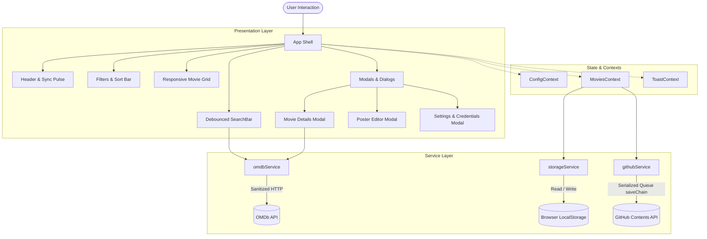

<div align="center">
  
  <h1>WatchTime</h1>
  <p><strong>A sleek, high-performance personal movie &amp; series watchlist synchronized directly with your GitHub repository.</strong></p>

  <p>
    <a href="https://Danushka-Madushan.github.io/watchtime/"><strong>Explore the Live Application »</strong></a>
  </p>

  <p>
    <a href="https://react.dev/"></a>
    <a href="https://vitejs.dev/"></a>
    <a href="https://www.typescriptlang.org/"></a>
    <a href="https://tailwindcss.com/"></a>
    <a href="https://github.com/Danushka-Madushan/watchtime/actions/workflows/deploy.yml"></a>
    <a href="LICENSE"></a>
  </p>

  <p>
    <a href="#-key-features">Key Features</a> •
    <a href="#-live-demo--deployment">Live Demo</a> •
    <a href="#-architecture">Architecture</a> •
    <a href="#-getting-started">Getting Started</a> •
    <a href="#-configuration-guide">Configuration</a> •
    <a href="#-security--hardening">Security</a> •
    <a href="#-type-safety">Type Safety</a>
  </p>
</div>

---

## 📖 Overview

**WatchTime** is a lightweight, privacy-focused media tracker designed for movie and television enthusiasts. Built entirely as a modern single-page client without requiring a dedicated backend server, WatchTime persists your collection directly to a `data/movies.json` file in your personal GitHub repository.

Enriched with real-time metadata from the OMDb API, WatchTime offers instant search with debounced autocomplete, optimistic status toggling, detailed modal previews, custom poster editing, and responsive multi-column layouts across desktop, tablet, and mobile.

---

## 🚀 Live Demo & Deployment

The application is deployed continuously to GitHub Pages using an automated GitHub Actions CI/CD pipeline.

- **Production URL**: [https://Danushka-Madushan.github.io/watchtime/](https://Danushka-Madushan.github.io/watchtime/)
- **CI/CD Workflow**: [`.github/workflows/deploy.yml`](.github/workflows/deploy.yml)

> [!TIP]
> WatchTime works out of the box in **Local Storage Mode** with a bundled seed library. You can add your GitHub credentials at any time in the Settings menu to sync your library across all your devices.

---

## ✨ Key Features

### 🔍 Real-Time OMDb Search & Smart Query Parsing
- **Debounced Autocomplete**: 400ms query debouncing eliminates redundant network traffic while providing live search suggestions.
- **Automatic Year Extraction**: Intelligently detects and separates trailing release years (e.g. typing `Inception 2010` searches title `Inception` filtered by year `2010`).
- **Media Type Segmentation**: Instant filtering between All Media, Movies, and TV Series directly from the search bar.
- **Duplicate Prevention**: Live badges flag items already present in your collection, preventing accidental re-additions.
- **Incremental Pagination**: Load additional search results on demand with an inline "Show more" loader.

### 🎬 Polished Movie Details Modal
- **Comprehensive Metadata**: Displays high-resolution poster art, release year, age rating (`PG-13`, `R`, etc.), runtime, genre badges, director, cast, and date added.
- **Ratings & Scores**: Live IMDb star ratings, vote counts, and Metascore badges.
- **Full Plot Synopsis**: Asynchronously retrieves the complete narrative plot when an OMDb API key is configured.
- **Direct Card Interaction**: Clicking any movie card poster opens the detail modal with full keyboard accessibility (`Enter` / `Space`).
- **In-Modal Quick Actions**: Toggle watched/unwatched status, change custom poster art, open IMDb in a secure new tab, or remove the title.

### 🏷️ Intuitive Filters & Dynamic Categorization
- **Segmented Status Tabs**: Instant switching between `All`, `To watch`, and `Watched` views with dynamic item count badges.
- **Wrap-Around Genre Badges**: All genres are displayed as wrap-around pills accessible at a glance without horizontal scrolling.
- **Custom Styled Sort Dropdown**: Modern select menu with `ArrowUpDown` and `ChevronDown` iconography:
  - *Recently Added* (newest first)
  - *Title (A–Z)* (alphabetical)
  - *Newest Release* (chronological by release year)

### 🖼️ Poster Customization & Safe Fallbacks
- **Custom Poster Overrides**: Assign custom image URLs with live 2:3 aspect-ratio preview and validation.
- **One-Click IMDb Refetch**: Retrieve the latest official poster from OMDb at any time.
- **Graceful Error Handling**: Broken or blocked external image URLs automatically fall back to an inline SVG placeholder.

### 🔄 GitHub Cloud Sync Engine
- **GitHub Contents API Integration**: Synchronizes your collection to `data/movies.json` in your repository.
- **Serialized Commit Queue (`saveChain`)**: Guarantees atomic, sequential commits via an in-memory Promise queue, eliminating Git blob SHA collisions and `409 Conflict` errors during rapid edits.
- **Optimistic UI**: Interface updates instantly while synchronization proceeds in the background.

### 🌓 Adaptive Theme Engine
- Seamless transitions between light and dark themes with persistent storage (`localStorage`).
- Automatic detection of system preference (`prefers-color-scheme`).
- Powered by native Tailwind CSS v4 `@theme` design tokens and CSS custom properties.

---

## 🛠️ Technology Stack

| Layer | Technology | Purpose |
|---|---|---|
| **Frontend Framework** | [React 19](https://react.dev/) | Functional architecture, modern hooks, and state management |
| **Build & Tooling** | [Vite 6](https://vitejs.dev/) | Lightning-fast HMR and optimized Rollup production bundling |
| **Language** | [TypeScript 5.7](https://www.typescriptlang.org/) | Strict mode with zero `any` types enforced across the codebase |
| **Styling** | [Tailwind CSS v4](https://tailwindcss.com/) | Modern CSS tokens, zero-runtime utilities, and CSS variables |
| **Iconography** | [Lucide React](https://lucide.dev/) | Consistent, accessible SVG icon primitives |
| **Sanitization** | [DOMPurify](https://github.com/cure53/DOMPurify) | Client-side input sanitization preventing XSS attacks |
| **Hosting & CI/CD** | [GitHub Actions & Pages](https://pages.github.com/) | Automated build verification and static edge hosting |

---

## 🏗️ Architecture



### Directory Structure

```
watchtime/
├── .github/
│   └── workflows/
│       └── deploy.yml          # GitHub Pages automated build & deployment workflow
├── data/
│   └── movies.json             # Seed movie collection bundled with production build
├── public/
│   └── favicon.svg             # Official vector SVG brand logo
├── src/
│   ├── main.tsx                # Application mount point
│   ├── App.tsx                 # Root application shell & modal orchestration
│   ├── index.css               # Tailwind CSS v4 design tokens and theme variables
│   ├── types/                  # Strict TypeScript data models & contracts
│   │   ├── config.ts           # AppConfig, RepoInfo, ConnectionTestResult
│   │   ├── movie.ts            # Movie, MediaType, ViewFilter, SortOption
│   │   ├── omdb.ts             # OMDb API response & search state interfaces
│   │   └── toast.ts            # Toast notification types
│   ├── services/               # API clients and persistence
│   │   ├── githubService.ts    # GitHub Contents API with serialized commit queue
│   │   ├── omdbService.ts      # OMDb API search, detail, and poster retrieval
│   │   └── storageService.ts   # LocalStorage persistence wrapper
│   ├── utils/                  # Pure utility helpers
│   │   ├── base64.ts           # UTF-8 safe Base64 encoder/decoder
│   │   ├── queryParser.ts      # Year extraction & search query parsing
│   │   └── sanitize.ts         # DOMPurify HTML & URL protocol sanitizer
│   ├── context/                # React context state providers
│   │   ├── ConfigContext.tsx   # Credentials and API keys state
│   │   ├── MoviesContext.tsx   # Collection state, filters, sorting & optimistic sync
│   │   └── ToastContext.tsx    # Reactive feedback notifications
│   └── components/             # Modular UI components
│       ├── Header/             # Header, logo, sync pulse, theme toggle
│       ├── Search/             # Debounced search input & autocomplete dropdown
│       ├── Filters/            # Status tabs, wrap-around genres, sort selector
│       ├── MovieGrid/          # Responsive grid, movie card, skeletons, empty state
│       ├── Modals/             # Movie details, poster editor, settings, confirm dialog
│       └── Toast/              # Toast notification stack
├── index.html                  # HTML entry point with Content Security Policy & fonts
├── package.json                # Dependencies and build scripts
├── tsconfig.json               # Root TypeScript configuration
├── tsconfig.app.json           # Strict application TypeScript rules
├── tsconfig.node.json          # Node / bundler TypeScript rules
└── vite.config.ts              # Vite configuration with dynamic base path support
```

---

## ⚡ Getting Started

### Prerequisites
- **Node.js**: `v18.0.0` or later (Node 20+ recommended)
- **npm**: `v9.0.0` or later

### Installation & Local Run

1. **Clone the repository**:
   ```bash
   git clone https://github.com/Danushka-Madushan/watchtime.git
   cd watchtime
   ```

2. **Install dependencies**:
   ```bash
   npm install
   ```

3. **Start the local development server**:
   ```bash
   npm run dev
   ```
   Open your browser at `http://localhost:5173`. In development mode, Vite automatically uses relative base path `./`.

---

## 📜 Available Scripts

| Script | Command | Description |
|---|---|---|
| `dev` | `npm run dev` | Launches the local development server with instant Hot Module Replacement (HMR) |
| `build` | `npm run build` | Compiles TypeScript (`tsc`) and outputs production bundle into `dist/` |
| `lint` | `npm run lint` | Runs strict TypeScript type-checking across the codebase (`tsc --noEmit`) |
| `preview` | `npm run preview` | Locally previews the production build from `dist/` |

---

## ⚙️ Configuration Guide

WatchTime requires zero server setup. All configuration values are stored securely in your browser's `localStorage` under the key `watchlist-cfg`.

### 1. OMDb API Key Setup
An OMDb API key is required to query movies, fetch extended plot synopses, and retrieve official poster artwork.

1. Obtain a free API key at [omdbapi.com/apikey.aspx](https://www.omdbapi.com/apikey.aspx).
2. Activate the key via the confirmation link sent to your email.
3. Open WatchTime, click the **Settings (gear icon)** in the top header.
4. Enter your key in the **OMDb API Key** field and click **Save Configuration**.

### 2. GitHub Synchronization (Cloud Storage)
To synchronize your watchlist across multiple browsers and devices using your own GitHub repository:

1. Create a repository on GitHub (e.g. `watchtime`) containing a `data/movies.json` file.
2. Generate a [Fine-grained Personal Access Token](https://github.com/settings/tokens?type=beta):
   - **Repository Access**: Select your watchlist repository.
   - **Repository Permissions**: Grant **Contents: Read and write**.
3. Open **Settings** in WatchTime and configure:
   - **GitHub Personal Access Token**: Paste your token (masked by default with show/hide toggle).
   - **Repository Owner**: Your GitHub username or organization.
   - **Repository Name**: The repository name (`watchtime`).
   - **Branch**: Target branch (e.g. `main`).
4. Click **Test Connection** to verify read/write access.
5. Click **Save Configuration** to pull your existing movies and enable automatic synchronization.

### 3. Local Storage Mode (Offline)
If no GitHub credentials are provided, WatchTime operates in **Local Storage Mode**. All changes persist in your browser's `localStorage`. You can transition to GitHub cloud sync at any time without losing data.

---

## 🔒 Security & Hardening

WatchTime applies comprehensive client-side security measures to protect user credentials and safeguard against code injection:

- **DOMPurify Sanitization**: All text content, titles, and genres are sanitized through DOMPurify before DOM insertion to neutralize Cross-Site Scripting (XSS).
- **Protocol Validation**: Poster URLs and links are validated against an allowlist (`http:`, `https:`). Dangerous schemes (`javascript:`, `data:`, `file:`) are strictly stripped.
- **Safe Outbound Links**: External links (e.g. IMDb, GitHub) enforce `target="_blank" rel="noopener noreferrer"` to prevent reverse tab-nabbing.
- **Referrer Privacy**: Movie poster images include `referrerpolicy="no-referrer"` to prevent leaking referrers to external media servers.
- **Credential Masking**: Sensitive tokens (GitHub PAT and OMDb API key) are masked with `type="password"` inputs and optional eye toggles.
- **Content Security Policy (CSP)**: `index.html` enforces a strict CSP meta header restricting script execution, style sources, and API connection domains.

---

## 🎯 Type Safety

WatchTime strictly adheres to a **Zero-`any` Policy** with full TypeScript strictness enabled:

- `strict: true`
- `noImplicitAny: true`
- `strictNullChecks: true`
- `noUncheckedIndexedAccess: true`
- `noUnusedLocals: true`

You can verify that zero `any` declarations exist across the entire codebase at any time:

```powershell
# PowerShell Zero-Any Audit
Get-ChildItem -Path "src" -Recurse -Include *.ts,*.tsx | Select-String -Pattern ":\s*any\b|\bas\s+any\b|<any>|any\[\]"
```

The audit returns **0 matches**, confirming complete type safety.

---

## 📄 License

This project is licensed under the [MIT License](LICENSE).
